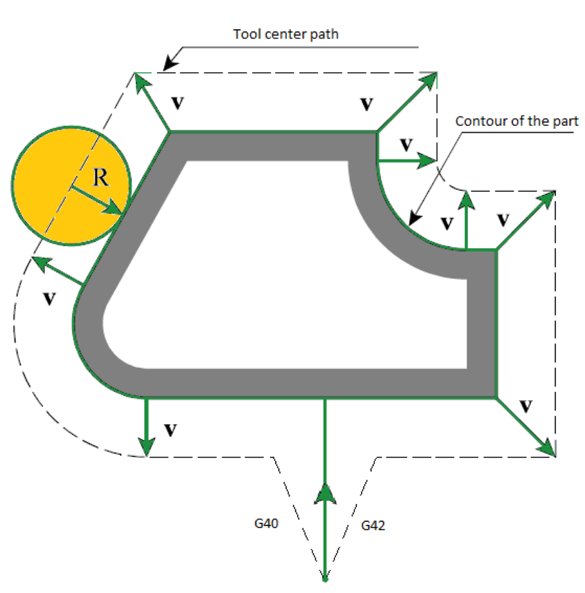
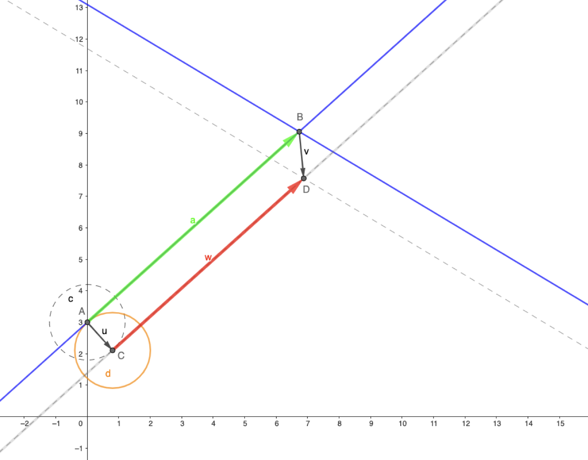
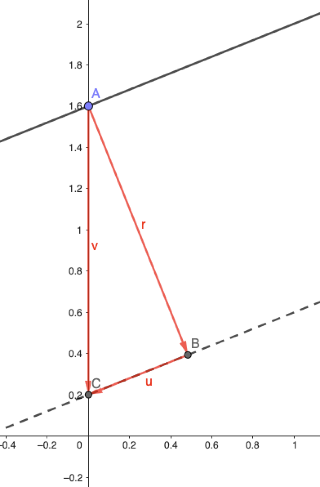
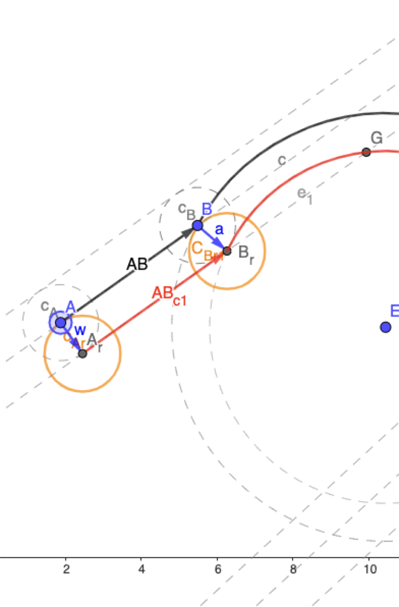
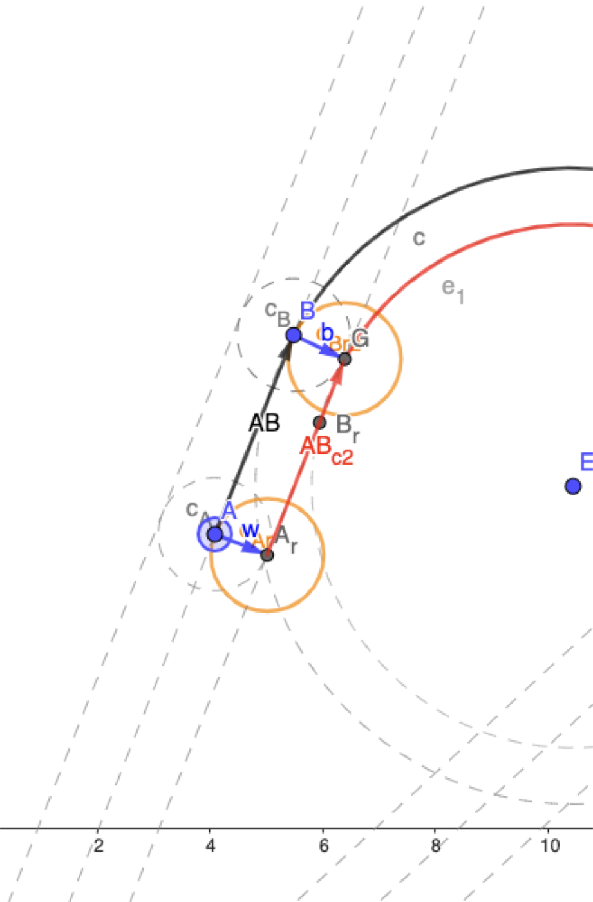

```{r}
#| include: false
options(width = 60)
knitr::opts_chunk$set(
  echo = FALSE,
  warning = FALSE
)
options(width = 60)
set.seed(0)
```


# Tool radius compensation (TRC)

A possible feature to implement for the personal project


## TRC and G-code

- G-code standard supports a feature for offsetting the tool trajectory to the left or to the right of the trajectory by an amount equal to the tool radius
- This is only affecting the X-Y projection of the trajectory, Z values remain unchanged
- The TRC is set to the left with `G41`, to the right with `G42` and is disabled with `G40`
- TRC is fully active at the end of the current block

## Tool radius compensation

:::: {.columns}
::: {.column width="50%"}
- TRC offsets the tool center path (programmed points) according to `G41`/`G42`
- New target points are calculated for each block on the basis of the offset intersection with the next block (arc or line)
- Disabled for rapid motions
:::
::: {.column width="50%"}
{height=460}
:::
::::

## Tool radius compensation: Line-Line

<iframe scrolling="no" title="LL offset" src="https://www.geogebra.org/material/iframe/id/mcv4egvk/width/2443/height/1183/border/888888/sfsb/true/smb/false/stb/false/stbh/false/ai/false/asb/false/sri/false/rc/false/ld/false/sdz/false/ctl/false" width="2443px" height="1183px" style="border:0px;"> </iframe>

<!-- Interactive example on <https://www.geogebra.org/m/mcv4egvk -->

## Tool radius compensation: Line-Circle

<iframe scrolling="no" title="lcl_intersection" src="https://www.geogebra.org/material/iframe/id/uwaa7u4v/width/2056/height/1031/border/888888/sfsb/true/smb/false/stb/false/stbh/false/ai/false/asb/false/sri/false/rc/false/ld/false/sdz/false/ctl/false" width="2056px" height="1031px" style="border:0px;"> </iframe>

<!-- Interactive example on <https://www.geogebra.org/m/uwaa7u4v -->

## Line-Line case

:::: {.columns}
::: {.column width="45%"}
We need to calculate the point $D$:

1. Given the line equation $y = ax + b$, we need to calculate the equation of the offset line(s)
2. Calculate $D$ as intercept between the two offset lines
:::
::: {.column width="55%"}
{height=430}
:::
::::

## Line-Line case

:::: {.columns}
::: {.column width="55%"}
- Given $y = ax + b$, the equation of the offset line is $y = ax + b - v$
- Being $a = u/r$, it follows that: $v = \sqrt{u^2 + r^2} = r\sqrt{a^2 + 1}$
- So, $y = ax + b \pm r\sqrt{a^2 + 1}$
- **The sign depends on G41/G42 and on the path direction**
:::
::: {.column width="45%"}
{height=470}
:::
::::

## Line-Line case

:::: {.columns}
::: {.column width="55%"}
Intersection $D$ between

$y = a_1 x + b_1 - v_1 = a_1 x + b_{o,1}$

and

$y = a_2 x + b_2 - v_2 = a_2 x + b_{o,2}$

has coordinates:

$$(x_i, y_i) = \left(\frac{b_{o,2} - b_{o,1}}{a_1 - a_2}, \frac{b_{o,1}a_2 - b_{o,2}a_1}{a_2 - a_1}\right)$$
:::
::: {.column width="45%"}
{height=430}
:::
::::

## Line-Line case

:::: {.columns}
::: {.column width="58%"}
- **Exception:** when two segments are collinear ($a = a_1 = a_2$), the intercept is undefined
- The new intersection node is set at an offset $r$ **perpendicular** to the segments

$$C = \begin{cases} (0, -r), & \text{when } a = 0 \\ r(s, -s/a) \text{ with } s = \frac{a}{|a|}\sqrt{\frac{a^2}{1 + a^2}}, & \text{otherwise} \end{cases}$$

:::
::: {.column width="42%"}
<iframe scrolling="no" title="intersection points" src="https://www.geogebra.org/material/iframe/id/pmdtaprr/width/600/height/500/border/888888/sfsb/true/smb/false/stb/false/stbh/false/ai/false/asb/false/sri/false/rc/false/ld/false/sdz/false/ctl/false" width="600px" height="500px" style="border:0px;"> </iframe>
:::
::::

## Line-Arc (or Arc-Line)

:::: {.columns}
::: {.column width="55%"}
Similar to line-line case, but with a caveat:

- Line-circle intersection gives two points, $G$ and $B_r$: you have to select the intersection that is closer to the node to be offset ($B$ in figure)

:::
::: {.column width="45%"}
{height=470}
:::
::::

## Line-Arc (or Arc-Line)

:::: {.columns}
::: {.column width="55%"}
Similar to line-line case, but with a caveat:

- Line-circle intersection gives two points, $G$ and $B_r$: you have to select the intersection that is closer to the node to be offset ($B$ in figure)

:::
::: {.column width="45%"}
{height=470}
:::
::::

## Code changes

**Support for G40/G41/G42**

- An `enum class TRCType` with `NONE`, `LEFT`, `RIGHT`
- An `TRCType _trc` field in the `BlockTRC` class
- Proper code in `BlockTRC::parse()`
- `_trc` shall be managed as a *modal* field (i.e. inherited from previous block)

## Code changes

**Support for tool radius**

- The YAML file needs to have a field as: `tools: [10.0, 8.0, 5.0, 2.5]` giving the list of available tools and respective radiuses
- The `Machine` class needs to properly load the tool list into a new field: `vector<data_t> _tools`
- Add `machine::tool_radius()`, which returns the radius of a given tool number

## Code changes

**Support for offset calculation**

- The method `Block::parse()` needs to change the target of the previous block if the previous block has `_trc != TRCType::NONE`
- The target must be changed according to the equations shown above and the radius of the current tool

## Code changes

**Support for offset calculation**

- Equations for intersections possibly require:
  - `Block::angle_with_prev()`: angle in radians with previous block
  - `Block::equation()`: returns $a$ and $b$ as output parameters (refs); for an arc, parameters of the implicit equation $(x - x_c)^2 + (y - y_c)^2 = r^2$ are available already
- These functions can be private

## Advanced TRC

<iframe scrolling="no" title="Advanced TRC" src="https://www.geogebra.org/material/iframe/id/yaqfn8ha/width/2056/height/1031/border/888888/sfsb/true/smb/false/stb/false/stbh/false/ai/false/asb/false/sri/false/rc/false/ld/false/sdz/false/ctl/false" width="2056px" height="1031px" style="border:0px;"> </iframe>

## Rules

* You must work alone (I'll check and compare results!)
* Document progress with commits published on GitHub (**private** repo shared with me)
* No help from my side, except these slides
* When you are done, you must discuss your work with me
  * If it works (no warnings, errors/errors, works as expected) and it is not copied, you get 30/30
* If you implement advanced TRC or impress me with some other clever addition, you get 30/30 *cum laude*
* Must be done before the end of next year
